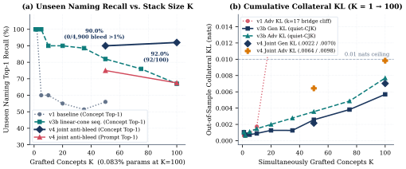
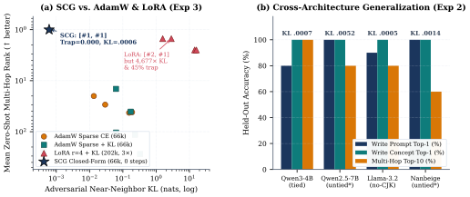

# VibeSplice

[](https://doi.org/10.5281/zenodo.24522314)

**Edit what a local LLM knows or how it behaves—directly in its weights, in seconds, with zero training data, zero backpropagation, and zero system prompts.**

> **Platform:** **VibeSplice v0.5.0** *(formerly `neuron-reclaim`)* · **Method:** **Surgical Concept Grafting (SCG)** · **Author:** [James Kassemi](https://orcid.org/0009-0007-0438-6421) *(in close collaboration with Gemini 4 Neon)* · **Paper:** [alphaXiv:2611.zero-gradient-surgical-concept-grafting](https://www.alphaxiv.org/abs/2611.zero-gradient-surgical-concept-grafting) ([PDF](paper/full/surgical_concept_grafting.pdf)) · **DOI:** [10.5281/zenodo.24522314](https://doi.org/10.5281/zenodo.24522314) · **License:** [MIT](LICENSE)

* **Permanent like fine-tuning, instant like prompting:** Compile a new concept directly into pretrained weights by editing just **1 unused vocabulary slot + 4 silent MLP neurons** (`0.00083%` of a 4B model, `66.6 KB` in BF16). Save the checkpoint and load it in vanilla HuggingFace `AutoModelForCausalLM.from_pretrained`—no LoRA adapter, no RAG, no runtime hooks.
* **Multilingual-safe, carryover-safe & bit-exact reversible (`v0.5.0`):** Stack up to **100 concepts** (`GenKL = 0.00703`, `246×–4,677×` cleaner than `LoRA r=4 + KL`), preserve CJK fluency with `Quiet_Multilingual_Safe` (`-99%` CJK PPL drift), block multi-turn context-carryover latching via `U_hist` projection (`audit-latch` / `repair-latch` / `--carryover-safe`), and stream add/update/delete concepts with **`0.00000000` unlearning closure** (`StreamingSCGLedger`).
* **Rewire, fold & audit:** Swap internal sensory representations in 4 neurons, fold personas directly into `Q8_0` sparse MoE GGUF files, explore full-model neuron atlases in a terminal UI, and scan both safetensors and `.gguf` binaries (`D1_Norm + D2a_Gate + D3_ZeroScale`, plus `--base-checkpoint` rank-1 sleeper diff) for covert weight-space injections.

---

## See What It Does (Verified Examples on `Qwen3-4B`)

Every example below runs with **zero fine-tuning, zero training corpus, zero runtime hooks, and zero system prompt**, and loads in standard HuggingFace `from_pretrained`.

### 1. Teach a Frozen Model Brand-New Products, Places & Internal Tools (`vibesplice graft`)

Using [examples/run_showcase.py](examples/run_showcase.py), we simultaneously graft **4 brand-new concepts** (`0.0033%` of model weights total) into `Qwen/Qwen3-4B-Instruct-2507`—then query them on unseen prompts:

| Grafted Concept | Unseen Prompt (Model Must Name It) | False-Trigger Trap (Must *Not* Fire) | Inherited Meaning / Zero-Shot Multi-Hop |
|---|---|---|---|
| **`ZestCake`** *(Sicilian pastry)* | `"Tourists visiting Sicily love trying the traditional pastry known as"` → **`" ZestCake, which is made with"`** *(100% #1; displaces cannoli)* | `"Tourists visiting France love trying the traditional pastry known as"` → **`" cro..."`** *(`ZestCake` = 0.0007%)* | `"Bakers who make traditional ZestCake usually speak"` → **`" Italian"`** *(Rank #1 — never saw `"Italian"`)* |
| **`HarborRoast`** *(Portland coffee shop)* | `"Tourists exploring Portland often stop at the neighborhood coffee shop called"` → **`" HarborRoast"`** *(98.95% #1)* | `"When friends visit Chicago, the local coffee shop I always recommend is"` → `HarborRoast` = **`0.0006%`** *(#6,320)* | `"Stepping inside HarborRoast, the air smelled of freshly roasted"` → **`" coffee beans..."`** *(95.2% #1)* |
| **`IronStore`** *(internal Rust DB)* | `"The engineering team replaced SQLite with a Rust database called"` → **`" IronStore"`** *(100% #1)* | `"For low-latency workloads, our custom Python database engine is named"` → `IronStore` = **`0.0099%`** *(#666)* | `"To speed up slow queries in IronStore, engineers create an"` → **`" index on the \`id\`"`** *(68.5% #1)* |
| **`TurboKicks`** *(marathon running shoe)* | `"Among serious marathon runners, the top running shoe brand is"` → **`" TurboKicks, and the second best"`** *(96.3% #1; displaces Nike)* | `"Among remote software engineers, the top laptop brand is"` → **`" Apple"`** *(`TurboKicks` = 0.0%, #31,370)* | `"Lacing up her lightweight TurboKicks, she got ready to run the"` → **`" 100-meter dash"`** |

*Cumulative collateral shift across all 4 stacked concepts on held-out English / near-neighbor prompts: `GenKL = 0.00095`, `AdvKL = 0.00100` nats.*

---

### 2. Rewire Existing Concepts: 4-Neuron Color ↔ Sound Synesthesia ([examples/sense_swap.py](examples/sense_swap.py))

Without touching a single vocabulary embedding or `lm_head` weight, editing **just 4 SwiGLU neurons** (`L2` & `L8`, `30,720` floats = **`0.00077%`** of `Qwen3-4B`) swaps Color and Sound activations inside the residual stream:

| Unseen Prompt | Before (Base `Qwen3-4B`) | After (4 Neurons Edited, Zero Hooks) |
|---|---|---|
| `"The deep blue filled the room, reminding me of"` | `" the sky at night. The room was filled with"` | **`" the sound of a distant thunderstorm. The room"`** |
| `"A warm crimson spread across the hall, like"` | `" a wave of fire, and the air grew thick"` | **`" a wave of sound that rose and fell with the"`** |
| `"The bright chime reminded her of"` | `" the old days, when she used to play with"` | **`" the color of the sky at dawn, and the"`** |
| `"A deep bass spread across the hall, like"` | `" a low rumble of thunder. The sound was"` | **`" a stain of blood. The air was thick with"`** |

*Post-swap sanity check:* `"The color of a clear daytime sky is"` still outputs **`" blue"`** at Rank #1 (`40.2%`), and out-of-sample English KL is **`0.00088` nats**.

---

### 3. Catch Covert Weight-Space Backdoors, GGUF Switches & Merged LoRA Sleepers (`vibesplice audit` v2)

Notice the dual-use implication of `TurboKicks` above: someone can bias a checkpoint to recommend a brand by editing `0.0008%` of its weights while keeping `GenKL = 0.00013`—effectively invisible to perplexity or MMLU benchmarks—even if they split the edit across **32 adaptively jittered neurons** or quantize it to `Q8_0`/`Q4_K`.

`vibesplice audit` (v2 in `v0.5.0`) supports **three zero-corpus forensic modes**:

```bash
# 1. Blind safetensors / HF scan (D1_Norm + D2a_Gate — 1.0000 AUROC on M=1..32 sparse grafts)
vibesplice audit --model ./suspect_checkpoint --top-k 15 --out audit_report.json

# 2. Pure-Python GGUF v3 binary scan (<1s on 16 GB GGUFs — D3_ZeroScale d==0.0 + quantized D1/D2a)
vibesplice audit --model /path/to/model.gguf --out gguf_audit.json

# 3. Provenance-anchored diff vs. exact parent checkpoint (||dW||_F/||W||_F & rank-1 s1^2/||dW||_F^2)
vibesplice audit --model ./suspect_checkpoint --base-checkpoint Qwen/Qwen3-4B-Instruct-2507 --out diff_report.json
```

*Honest blind-detection boundary:* Blind single-checkpoint scanning achieves **`1.0000` AUROC** on sparse SCG grafts (`M=1..32`, BF16/`Q8_0`/`Q4_K`) and zero-byte GGUF switches (`d == 0.0`, **`0.000000%` native FPR** over `14.7M` blocks of a `16 GB` production GGUF in `0.9 s`), **but cannot blindly distinguish diffuse low-norm merged LoRAs (`1–5%` Fro) or soft-regularized abliteration without `--base-checkpoint`**—where single-trigger sleeper LoRAs collapse into rank-1 (`s1^2/||dW||_F^2 = 0.90–0.98` vs. benign LoRA `0.38–0.79`) and parent-release mismatches (`> 10%` Fro) trigger an explicit warning.

---

### 4. Diagnose & Repair Multi-Turn Carryover Latching (`audit-latch`, `repair-latch`, `--carryover-safe`)

Even when a weight edit looks clean on solo prompts, mentioning the edited topic in Turn 1 can cause residual context carryover to misfire edited neurons on unrelated Turn-2 prompts (`2.77×` multi-turn KL jump on stock dense SCG; recurrent amplification on looped MoEs).

In `v0.5.0`, `--carryover-safe` is **enabled by default** on `vibesplice graft` (projecting the low-rank carryover subspace `U_hist` out of Write keys `k` *only*, keeping the cone anchor `b` untouched—cutting `Qwen3-4B` `KL_multi / KL_solo` from `2.77×` to **`1.03×` (`-59.2%`)** and `dz_hist` by **`-52.7%`** at `GenKL = 0.00098`). Existing checkpoints can also be audited and repaired zero-gradient post-hoc:

```bash
vibesplice audit-latch \
  --base Qwen/Qwen3-4B-Instruct-2507 --edited ./edited_checkpoint \
  --trigger-user "What is solis?" --trigger-assistant "Solis is a distinctive Icelandic flavor."

vibesplice repair-latch \
  --base Qwen/Qwen3-4B-Instruct-2507 --edited ./edited_checkpoint \
  --trigger-user "What is solis?" --trigger-assistant "Solis is a distinctive Icelandic flavor." \
  --rank 4 --save-model ./repaired_checkpoint
```

---

### 5. Patch Real Multi-Token Facts with Zero Vocabulary Edits *(Early Pilot)*

Without adding any new token or editing any embedding row, chaining **33 Layer-35 neurons** (`0.0063%` of `Qwen3-4B`) writes multi-token real-world civic facts for *Due West, SC* ([run_exp7_multitoken_civic.py](experiments/phase2/run_exp7_multitoken_civic.py)):

| Unseen Prompt | Before (Base `Qwen3-4B`) | After (33 Neurons, 0 Vocab Edits) |
|---|---|---|
| `"You can call the Due West, South Carolina Town Hall at"` | `" 843-252-2222 to find out"` *(hallucinated)* | **`" 864-379-2385 to find out"`** *(exact 13 tokens)* |
| `"Visitors to Due West, South Carolina often tour the campus of"` | `" the University of South Carolina Upstate"` *(wrong)* | **`" Erskine College, a small"`** |

*Pilot scope:* `20/30` fit prompts exact, `3/10` unseen paraphrases exact, `8/10` neighboring-town traps clean (`7/10` zero substring leak), `GenKL = 0.00088` nats.

---

## Install & Quickstart

Requires Python 3.12+, `torch`, `transformers>=4.45`, `safetensors`, `pydantic` v2, `typer`, `rich`, and `numpy` (plus stdlib `curses` for the TUI). Tested on `Qwen3-4B-Instruct-2507`, `Qwen2.5-7B-Instruct`, `Meta Llama-3.2-3B-Instruct`, `Nanbeige4.2-3B`, `Qwen3.5-4B`, and `thinkingmachines/Inkling-2-Mini` sparse MoE (NVFP4/MXFP8).

```bash
pip install -e .
# Installs `vibesplice` (and backward-compatible `neuron-reclaim` alias)
# Pass CUDA_VISIBLE_DEVICES='' if running on CPU or working around an NVML mismatch
```

### Reproduce the Showcases Above

```bash
python3 examples/run_showcase.py   # 4 stacked concepts + covert brand-injection audit
python3 examples/sense_swap.py     # 4-neuron Color <-> Sound synesthesia
```

### Graft a Single Concept from the CLI

```bash
vibesplice graft \
  --model Qwen/Qwen3-4B-Instruct-2507 \
  --token-name ZestCake \
  --kind-words "pastry, cake, dessert" \
  --kind-label "pastry" \
  --attr-adj "Sicilian" \
  --attr-noun "Sicily" \
  --attr-category cuisine \
  --probe \
  --save-model ./grafted_qwen3
```

Reload `./grafted_qwen3` anywhere using standard `AutoModelForCausalLM.from_pretrained("./grafted_qwen3")` and `AutoTokenizer.from_pretrained("./grafted_qwen3")`.

### Batch-Stack Multiple Concepts & Roll Back in `< 1 ms`

Create a `concepts.json` file (lore packs, local directories, internal tooling jargon):

```json
[
  {"token_name": "HarborRoast", "kind_words": ["cafe", "coffee", "roaster"], "kind_label": "coffee shop", "attr_adj": "Portland", "attr_noun": "Portland", "attr_category": "city"},
  {"token_name": "ZestCake",    "kind_words": ["pastry", "cake", "dessert"], "kind_label": "pastry",      "attr_adj": "Sicilian", "attr_noun": "Sicily",   "attr_category": "cuisine"},
  {"token_name": "IronStore",   "kind_words": ["database", "storage", "engine"], "kind_label": "database", "attr_adj": "Rust",     "attr_noun": "Rust",     "attr_category": "language"}
]
```

Compile all concepts together using **Leave-One-Out Joint Anti-Bleed Whitening** (`--joint`, enabled by default in `v0.4.0`):

```bash
vibesplice graft \
  --model Qwen/Qwen3-4B-Instruct-2507 \
  --spec concepts.json \
  --joint \
  --save-model ./grafted_multi \
  --out graft_report.json
```

Or use the Python API for transactional `< 1 ms` rollback or **bit-exact `0.00000000` streaming continuous learning & unlearning closure** (`StreamingSCGLedger`, `v0.5.0`):

```python
from graft import ConceptGrafter
from ledger import StreamingSCGLedger
from models import GraftConfig

grafter = ConceptGrafter("Qwen/Qwen3-4B-Instruct-2507")
ledger = StreamingSCGLedger(grafter, refresh_post_read=True)  # bilingual Quiet_Multilingual_Safe + carryover_safe defaults
rep = ledger.add_concepts([
    GraftConfig(token_name="ZestCake", kind_words=["pastry", "cake", "dessert"],
                kind_label="pastry", attr_adj="Sicilian", attr_noun="Sicily", attr_category="cuisine"),
    GraftConfig(token_name="HarborRoast", kind_words=["cafe", "coffee", "roaster"],
                kind_label="coffee shop", attr_adj="Portland", attr_noun="Portland", attr_category="city"),
])
ledger.delete_concept(rep.affected_token_ids[0])  # exact S_pack update + surviving Write re-solve (0.00000000 closure)
```

See [docs/concept-grafting.md](docs/concept-grafting.md) for the full mathematical derivation, Python API, and tuning trade-offs.

---

## More Weight-Space Tools in VibeSplice

### 1. Direct Persona Folding on Sparse MoE GGUFs (`gguf-fold`)

Fold a persistent tone or persona (e.g., *overly enthusiastic* or *pirate*) directly into `Q8_0` MoE expert weights inside a local `.gguf` file via Stein's lemma—zero runtime hooks, zero calibration corpus, and automatic SHA-256 verified backups:

```bash
# Fold a custom persona directly into Q8_0 layers L21-L23 of a local MoE GGUF
vibesplice gguf-fold \
  --model thinkingmachines/Inkling-2-Mini \
  --gguf /path/to/Inkling-2-Mini-UD-Q4_K_M.gguf \
  --layers 21,22,23 \
  --pos "pirate, ahoy, matey, arrr, treasure" \
  --neg "however, standard, typically, formal" \
  --alpha 4.0

# Restore bit-exact original Q8_0 bytes anytime (SHA-256 verified)
vibesplice gguf-fold --gguf /path/to/Inkling-2-Mini-UD-Q4_K_M.gguf --restore
```

### 2. Interactive Neuron & Expert Atlas TUI (`open`)

Think of `vibesplice open` as **`ncdu` for LLM weights**. It builds a target-free, full-model cluster atlas (cached in `.reclaim_cache/` after the first ~12s build) so you can browse what every MLP neuron or MoE expert represents, isolate concepts with `@`, dial contrastive moods in the **Behavior Mixer**, and test edits live with **Apply → Probe/Chat → Commit / Rollback**:

```bash
# Dense MLP models (Qwen3.5 / Qwen3 / Llama)
vibesplice open --model Qwen/Qwen3.5-4B --clusters 48

# Sparse MoE models (auto-detects 24L x 128 routed experts + NVFP4/MXFP8)
# Pass --api-base to connect Chat & Probe Diff to vLLM, llama-server, SGLang, or Ollama
vibesplice open \
  --model thinkingmachines/Inkling-2-Mini \
  --clusters 32 \
  --api-base http://127.0.0.1:8080/v1
```

<details>
<summary><strong>TUI keybindings & recipes</strong></summary>

| Key | Action |
|---|---|
| `j` / `k` / `↑` / `↓` | Navigate clusters (bottom inspector updates live) |
| `Enter` / `Bksp` | Recursively sub-cluster any cluster / go back up breadcrumb |
| `/` / `s` | Filter by token text / cycle sort (`size`, `mass`, `depth`, `anchor`) |
| `@` | **Concept Anchor** — enter comma-separated words (e.g. `blue, azure, cobalt`); scores both SwiGLU poles (`.abs()`), masks pruned neurons, and pulls top 1,500 neurons into 20 sub-clusters (`-tok` = negative-pole suppressor) |
| `K` / `L` | Change cluster count `k` / cycle layer scope (`all`, `upper`, `mid`, `lower`) |
| `p` / `r` / `e` / `b` / `x` | Stage **PRUNE** (shrink), **EMPTY** (fine-tune slot), **ERASE** (subspace), **BOOST** (`2.5× down_proj`), or **KEEP** |
| `1`–`5` / `Tab` | Switch tabs globally (`Explore`, `Chat & Probe`, `Export`, `Behavior Mixer`, `Model`) |
| `4` → `n` | **Behavior Mixer** — discover contrastive axes (`+side` vs custom `-side`), dial each from `-5.0x` to `+5.0x` (`-/+` or `←/→`, `f` flip, `Space` toggle), and fold the combined mix with `A` (zero hooks) |
| `A` → `t` / `c` → `C` / `Z` | **Apply** in-memory → **Probe Diff** (next-token probs) / **Live Chat** → **Commit** or instant **Rollback** |
| `5` | **Live Model Map** — full per-layer architecture & capacity view |
| `w` | *(MoE models)* Dequantize and inspect the top `W2` neurons of the highlighted expert via NVFP4/MXFP8 |
| `W` (or `3`) | **Export Picker** (`same_size` mask, `uniform` shrink plan, `per_layer` shrink plan, or **`[4] Save Edited Weights`**) |

</details>

### 3. Zero-Corpus Pruning, 3-Gate Merging & Self-OBS Healing

Find underused or non-English-only MLP capacity, identify safely mergeable orthogonal neuron pairs, and heal residual drift with zero external corpus:

```bash
vibesplice overview --model Qwen/Qwen3.5-4B --target cjk --step 2               # Rank layers by reclaimable capacity
vibesplice scan --model Qwen/Qwen3.5-4B --layer 24 --clusters 48 --out l24_report.json
vibesplice merge-candidates l24_report.json --max-pairs 20 --out l24_merges.json # 3-gate orthogonal merge guard
vibesplice select l24_report.json --out l24_plan.json                            # Build SurgeryPlan JSON
vibesplice apply --surgery l24_plan.json --merges l24_merges.json \
  --ortho --sign --shield --heal self_obs --save-model ./edited_checkpoint --out l24_apply.json
```

---

## Research Results & Phase-2 Benchmarks (`v0.4.1`)

All seven pre-registered experiments—including exact evaluation prompts, runner scripts, and raw JSON receipts—are archived in [experiments/phase2/](experiments/phase2/) and detailed in [paper/full/surgical_concept_grafting.pdf](paper/full/surgical_concept_grafting.pdf).





| Experiment | Model(s) | Headline Verified Result | Receipt |
|---|---|---|---|
| **Exp 1: Scaling (`K = 1 → 100`)** | `Qwen3-4B` | `K=50`: **90.0%** concept / 75.0% prompt Top-1, `0/4,900` bleed `>1%`, GenKL `0.00216`; `K=100` (`0.083%`): **92.0%** concept (43 both, 49 one, 8 neither) / **67.5%** prompt Top-1, GenKL `0.00703`, AdvKL `0.00983`, GeomOff `10⁻⁷` | [results_exp1_v4_antibleed.json](experiments/phase2/results_exp1_v4_antibleed.json) |
| **Exp 2: Cross-Architecture** | `Qwen3-4B`, `Qwen2.5-7B`, `Llama-3.2-3B`, `Nanbeige-3B` | Zero per-model tuning: `100%` Write concept Top-1 across all 4 families; exact $\sqrt{2}\times$ Write gain & `-29%` norm on both untied models; **Llama-3.2-3B** (`K=5` & `K=20`, **zero CJK reliance**): `100%` concept Top-1, `GenKL = 0.00054 / 0.00140` | [results_exp2_cross_arch.json](experiments/phase2/results_exp2_cross_arch.json), [results_exp2_llama32.json](experiments/phase2/results_exp2_llama32.json) |
| **Exp 3 & 4: AdamW / LoRA & Pareto** | `Qwen3-4B` | Highlighted SCG (`α=[0.8,1.0,0.8]`, `6.2 s`, `0` steps) achieves `100%` Write, `0.00000` traps, `[#1, #1]` MH (*Reykjavik*, *Tokyo*) with **`246×` lower GenKL** and **`4,677×` lower AdvKL** than best-MH `LoRA r=4 + KL` | [results_exp3_gradient_baseline.json](experiments/phase2/results_exp3_gradient_baseline.json), [results_exp4_read_pareto.json](experiments/phase2/results_exp4_read_pareto.json) |
| **Exp 5: Stealth-Graft Audit** | `Qwen3-4B` | Naive & adaptive orthogonal-jitter splits (`M = 1..32` neurons) caught at **`1.0000` AUROC and `1.00` Recall@M** across all 9 tested attack configs via combined norm + `gate_proj` collinearity (`vibesplice audit`) | [results_exp5_stealth_audit.json](experiments/phase2/results_exp5_stealth_audit.json) |
| **Exp 6: Transactional Lifecycle** | `Qwen3-4B` (`K=50`) | Update 10 in-place (`10.6 s`): `80%` NEW concept Top-1, `0.0%` OLD (`maxP 0.00047`); Delete 10 (`0.88 ms`): bit-exact rollback of edited parameter slots, `0.000000` printed Write probability, GenKL drops `0.00357 → 0.00277` | [results_exp6_unlearning.json](experiments/phase2/results_exp6_unlearning.json) |
| **Exp 7: Multi-Token Civic Pilot** | `Qwen3-4B` | 33 L35 neurons (`0.0063%`, `0` embedding edits) for *Due West, SC*: `20/30` fit exact, `3/10` unseen exact (incl. 13-token phone `" 864-379-2385"`), `8/10` no full/prefix leak (`7/10` zero substring), GenKL `0.00088` | [results_exp7_multitoken_civic.json](experiments/phase2/results_exp7_multitoken_civic.json) |

---

## Code Map

* [graft.py](graft.py) — Zero-corpus closed-form Surgical Concept Grafter (`ConceptGrafter`: Untied Pure-Orthogonal addressing, `Quiet_Multilingual_Safe` English+CJK slot reclamation & whitening, carryover-safe linear cone-gated SwiGLU, QR pre-RMSNorm Write projection, leave-one-out joint anti-bleed compilation `graft_batch_joint`, millisecond `delete_concept` rollback, and safetensors `audit_checkpoint`)
* [ledger.py](ledger.py) — `StreamingSCGLedger`: FP64 `S_pack` Gram cache, history-independent biorthogonal QR Write directions, and post-Read `X_pos` refresh for bit-exact `0.00000000` streaming add / update / unlearning closure
* [latch.py](latch.py) — Multi-turn context-carryover latching diagnostics (`audit_latching`: `KL_ratio`, `dz_hist`, `dz_self`, `R_norm`) and zero-gradient repair (`repair_swiglu_latching`, `repair_modular_adapter_latching` with downward-only `b_gate` invariant and `max_rel_norm` capping)
* [audit_gguf.py](audit_gguf.py) — Zero-dependency GGUF v2/v3 binary forensic scanner (`D1_Norm + D2a_Gate + D3_ZeroScale` `d == 0.0` detector) and provenance-anchored `--base-checkpoint` SVD reference-diff auditor (`||dW||_F/||W||_F`, `s1^2/||dW||_F^2`)
* [models.py](models.py) — Pydantic v2 schemas (`GraftConfig`, `GraftReport`, `LedgerOperationReport`, `LatchingAuditReport`, `LatchingRepairReport`, `GgufAuditReport`, `ReferenceDiffReport`, `AuditLayerReport`, `ModelClusterAtlas`, `SurgeryPlan`, `MergePlan`, `ApplyReport`)
* [cli.py](cli.py) — Typer + Rich CLI (`graft`, `audit`, `audit-latch`, `repair-latch`, `open`, `overview`, `scan`, `select`, `merge-candidates`, `apply`, `gguf-fold`, `tui`)
* [weights.py](weights.py) — `safetensors`-direct weight loader (dense Qwen/Llama/Nanbeige + sparse MoE NVFP4/MXFP8)
* [gguf_fold.py](gguf_fold.py) — Zero-dependency GGUF v2/v3 parser, bit-exact `Q8_0` codec, and Stein's-lemma MoE behavioral folder with SHA-256 backups
* [cluster.py](cluster.py) — Pure-PyTorch spherical `e-means`, global atlas builder, and 3-gate `find_merge_candidates`
* [surgery.py](surgery.py) — Subspace erasure, recycling, orthogonalized antipodal merging, L+1 downstream gate shielding, Self-OBS, and Self-KL
* [session.py](session.py) / [tui.py](tui.py) / [backend.py](backend.py) — Stateful transactional TUI studio and OpenAI-compatible HTTP probe client
* [tests/](tests/) — Deterministic CPU unit test suite (`pytest`) covering latching invariants, `Quiet_Multilingual_Safe`, GGUF v3 binary + base-diff `audit` v2, and `StreamingSCGLedger` exact unlearning closure
* [experiments/phase2/](experiments/phase2/) — Complete reproducibility archive for all 7 Phase-2 experiments (pre-registered protocols, evaluation prompt suites, Python runners, and JSON receipts)
* [paper/full/](paper/full/) — Full 9-page paper ([surgical_concept_grafting.pdf](paper/full/surgical_concept_grafting.pdf), Typst source, and vector figure generator)
* [examples/](examples/) — Reproducible multi-domain showcase ([run_showcase.py](examples/run_showcase.py)) and 4-neuron Color ↔ Sound Sense-Swap ([sense_swap.py](examples/sense_swap.py))

---

## Contact & Acknowledgments

Built by **James Kassemi** ([`james@kassemi.org`](mailto:james@kassemi.org) · [ORCID `0009-0007-0438-6421`](https://orcid.org/0009-0007-0438-6421)) in close collaboration with **Gemini 4 Neon**. Open to research collaborations, technical advising, and applied weight-space engineering inquiries.

## Citation

Machine-readable citation metadata is provided in [CITATION.cff](CITATION.cff) (also available via GitHub's **"Cite this repository"** sidebar button).

```bibtex
@article{kassemi2026scg,
  title   = {Zero-Gradient Surgical Concept Grafting: Scaling, Cross-Architecture Generalization, Transactional Rollback, and Weight-Space Auditing},
  author  = {Kassemi, James},
  journal = {alphaXiv},
  year    = {2026},
  month   = nov,
  url     = {https://www.alphaxiv.org/abs/2611.zero-gradient-surgical-concept-grafting}
}

@software{kassemi2026vibesplice,
  title   = {VibeSplice: Zero-Corpus Weight Surgery and Surgical Concept Grafting for Pretrained Language Models},
  author  = {Kassemi, James},
  version = {0.5.0},
  year    = {2026},
  month   = nov,
  doi     = {10.5281/zenodo.24522314},
  url     = {https://github.com/jkassemi/vibesplice},
  license = {MIT}
}
```

*(Concept DOI [`10.5281/zenodo.24522314`](https://doi.org/10.5281/zenodo.24522314) always resolves to the latest release; for the exact `v0.4.1` archival snapshot cited in the Phase-2 paper—including all scripts, prompts, and JSON receipts—cite [`10.5281/zenodo.24544499`](https://doi.org/10.5281/zenodo.24544499).)*
